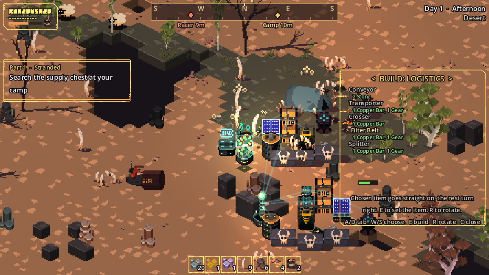
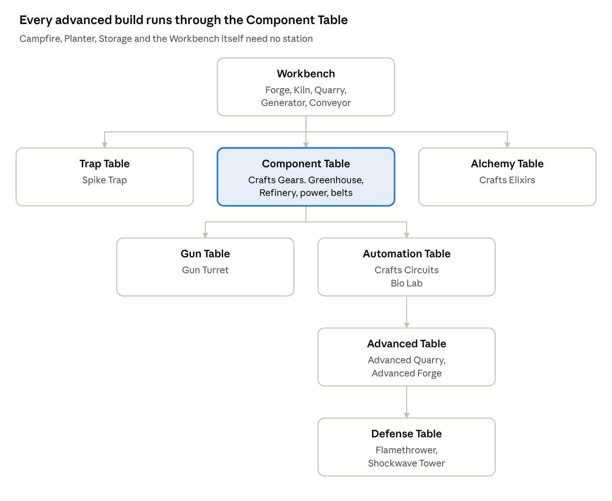

# Building

Open the build menu to place structures. Each one goes on the cell in front of you, shown by a ghost that turns green when the spot is free and red when it's blocked.

- **Stations gate recipes.** Most structures can only be built while you stand near a particular crafting station. Locked entries show that station's name in brackets.
- **Dismantling** removes the structure in front of you (or the nearest one in reach) and refunds its full cost plus anything stored inside.
- **Your base keeps working.** Structures never despawn, and machines keep running while you're far away.
- **Buildings can be damaged.** Raiders attack them at night. See [Base raids](../combat/base-raids.md#building-health) for health and repair.

## The tech tree

Build each station near the one before it. The **Component Table** opens power, belts and food automation, so it's the first big goal.

| Station | Unlocks | Also crafts |
| --- | --- | --- |
| *(none needed)* | Campfire, Planter, Storage, Workbench | |
| Workbench | Trap Table, Alchemy Table, Component Table, Forge, Kiln, Quarry, Generator, Conveyor | |
| Trap Table | Spike Trap | |
| Alchemy Table | | Elixir |
| Component Table | Gun Table, Automation Table, Fuel Refinery, Greenhouse, Solar Panel, Battery Bank, Coil, Transporter, Crosser, Filter Belt, Splitter | Gear |
| Gun Table | Gun Turret | |
| Automation Table | Advanced Table, Bio Lab | Circuit |
| Advanced Table | Defense Table, Advanced Quarry, Advanced Forge | |
| Defense Table | Flamethrower, Shockwave Tower | |

Stations that craft items do so when you use them, as long as you carry the ingredients. See [Items](../reference/items.md#processed-materials).

## In this section

-   :material-currency-usd:{ .lg .middle } **[Build costs](costs.md)**

    Every structure, its cost and where to build it.

-   :material-cog:{ .lg .middle } **[Production](production.md)**

    Quarries, kilns, refineries, greenhouses and the Bio Lab.

-   :material-flash:{ .lg .middle } **[Power](power.md)**

    Generators, solar, batteries, coils and brownouts.

-   :material-transit-connection-variant:{ .lg .middle } **[Logistics](logistics.md)**

    Belts, transporters, filters and splitters.

-   :material-shield-sword:{ .lg .middle } **[Defenses and upgrades](defense.md)**

    Turrets, traps, flamethrowers, shockwaves and sword upgrades.

