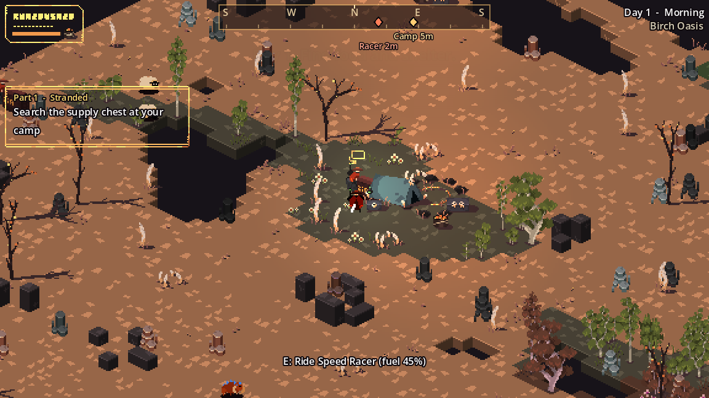
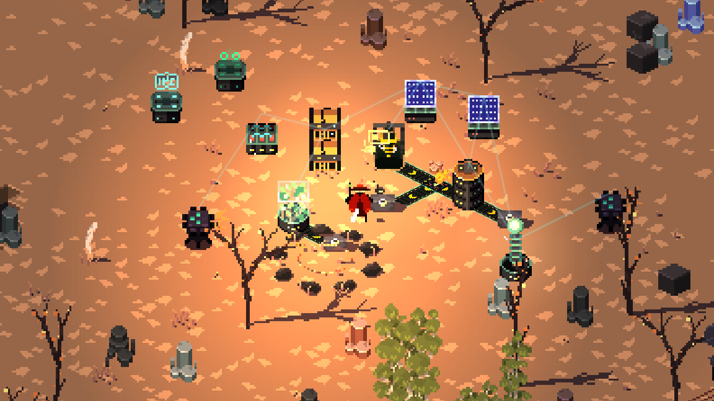

---
hide:
  - navigation
  - toc
---

# Ashen Wilds

Stranded in an endless desert with nothing but a sword. Scavenge the oases, build machines that keep you alive, and hold the line when the raiders come at night.

[Start playing :material-arrow-right:](start/index.md){ .md-button .md-button--primary }
[Browse items](reference/items.md){ .md-button }

<strong>∞</strong>procedural desert

<strong>7</strong>oasis biomes

<strong>32</strong>buildable structures

<strong>30</strong>tutorial objectives

<strong>1</strong>save. Death is final.

## Find your way

-   :material-flag-checkered:{ .lg .middle } **Start here**

    ---

    What the game is, how a run works, and a day-by-day plan for your first week.

    [:octicons-arrow-right-24: First days](start/first-days.md)

-   :material-earth:{ .lg .middle } **The world**

    ---

    Biomes, landmarks, the day cycle, sandstorms and the caves beneath the sand.

    [:octicons-arrow-right-24: Explore](world/index.md)

-   :material-food-drumstick:{ .lg .middle } **Survival**

    ---

    Health, stamina and hunger, every food in the game, and the three buffs.

    [:octicons-arrow-right-24: Stay alive](survival/index.md)

-   :material-sword-cross:{ .lg .middle } **Combat**

    ---

    Your sword, every raider and animal, base raids, the Dust Jumper, and your drone.

    [:octicons-arrow-right-24: Fight](combat/index.md)

-   :material-factory:{ .lg .middle } **Building**

    ---

    The tech tree, quarries and kilns, power grids, belts with filters and splitters, and turrets.

    [:octicons-arrow-right-24: Automate](building/index.md)

-   :material-book-open-variant:{ .lg .middle } **Reference**

    ---

    Controls, menus and settings, an index of every item, saving, and common questions.

    [:octicons-arrow-right-24: Look it up](reference/index.md)

## The core loop

1. **Scavenge.** Loot the starting camp, chop trees, mine rocks, hunt and forage in your oasis.
2. **Climb the tech tree.** Each crafting station unlocks the next set of buildings.
3. **Automate.** Wild resources never grow back. Quarries, kilns, greenhouses, power and conveyor belts make them for you.
4. **Defend.** Every night the raids grow. Turrets, traps and your companion drone guard the base, and from day 3 the Dust Jumper may come hunting.

<figure markdown>

<figcaption>A base on day 3: a quarry feeds a filter belt that sends copper to the kiln, a greenhouse fills a chest, and solar panels, a generator and a battery power it all.</figcaption>
</figure>

!!! tip "New here?"
    You don't need to read anything before playing. The in-game [objectives](start/objectives.md) teach every system one step at a time. Come back to this wiki when you want the numbers.
