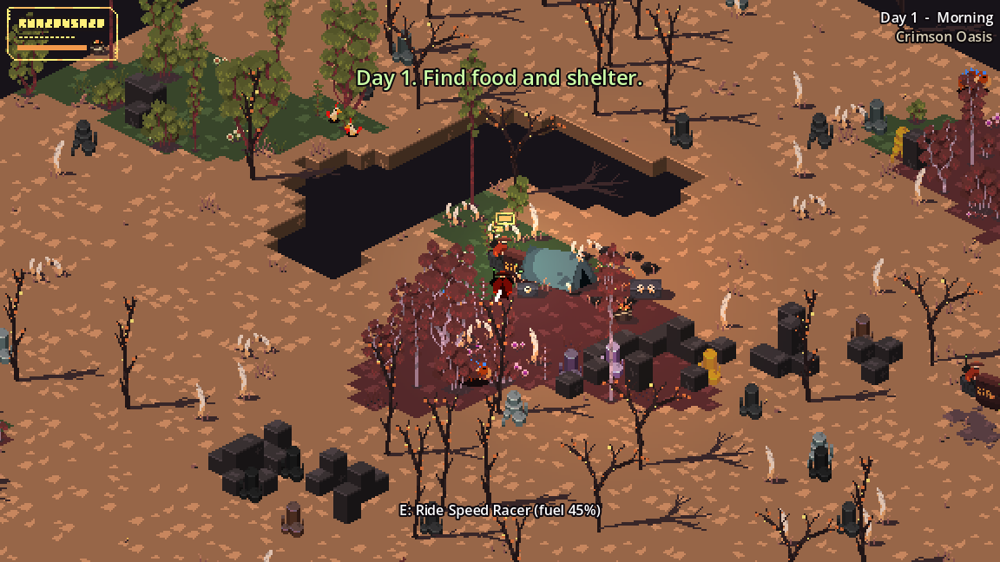
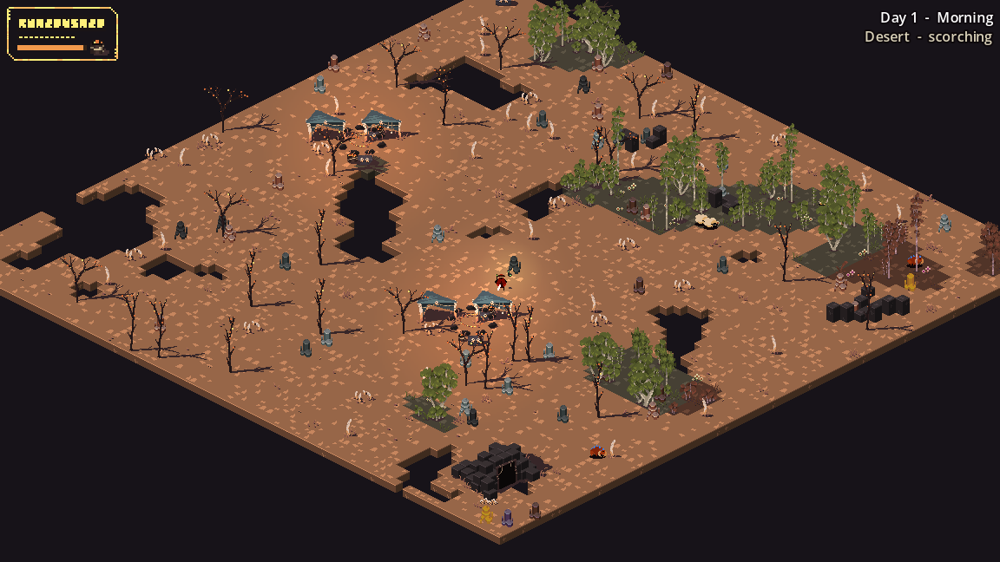

# Ashen Wilds

Ashen Wilds is an isometric pixel-art survival and automation game. You are a lone swordsman stranded in an endless desert, and the goal is to survive as many days as you can.

The world is procedurally generated from a random seed and has no edge. Most of it is barren sand; life clings to small, scattered oases. Wild resources are thin and never grow back, so long-term survival depends on building machines that mine, smelt, grow and defend for you.

## The core loop

1. Scavenge the starting camp, then gather wood, stone and ore and hunt or forage for food.
2. Build stations to climb the [tech tree](building.md).
3. Automate: [quarries, kilns, greenhouses](production.md), [power](power.md) and [conveyor belts](logistics.md).
4. Defend your base each night against [escalating raids](day-night.md), including the [Dust Jumper boss](combat.md#the-dust-jumper-boss).

A run ends when your health reaches zero. The death screen shows days survived, raiders slain and structures built.

## Where to start

- New players: read [Getting started](getting-started.md), then [Controls](controls.md).
- Looking for a specific item? See [Items and how to get them](items.md).
- Planning a factory? See [Production](production.md), [Power](power.md) and [Logistics](logistics.md).

