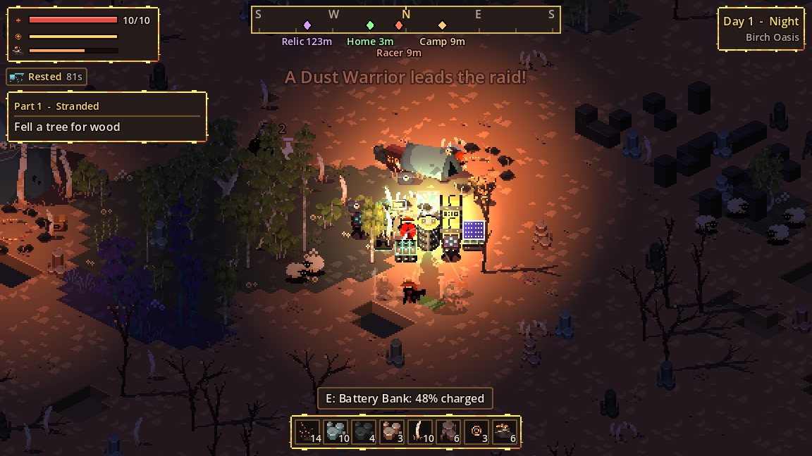

# First days

Use day 1 to get a workbench and a fire up. Spend the next few days building toward a quarry, a kiln and a greenhouse, and by day 5 your base should be feeding and defending itself.

The [objectives](objectives.md) on the left of the screen walk you through the same path. If you get lost, follow the compass's **Camp** and **Home** markers.

=== "Day 1"

    1. Open the supply chest beside the tent. It holds 14 Wood, 10 Stone, 6 Berries, 3 Copper Ore and 4 Coal.
    2. Build a **Workbench** (10 Wood, 6 Stone) in or near your oasis. This is your Home marker from now on.
    3. Chop trees, hunt animals and pick berry bushes.
    4. Before dusk, build a **Campfire** (6 Wood, 3 Stone). Cook your meat and stand in its light for a few seconds to become [Rested](../survival/buffs.md).
    5. When raiders come, [roll](../combat/index.md#rolling) through their swings and use heavy chops on the tougher ones.

=== "Days 2–4"

    1. Ride the [Speed Racer](../world/speed-racer.md) to rock outcrops and deposits for stone, copper and coal.
    2. Build a **Generator** (3 Copper Ore, 8 Stone) and load it with coal or wood.
    3. Build a **Quarry** (10 Stone, 6 Wood, 3 Copper Ore) and a **Kiln** (14 Stone, 3 Coal) inside the generator's reach.
    4. Smelt 4 Copper Bars and build the **Component Table**. It unlocks the Greenhouse, solar power, batteries and belts.
    5. Build a **Greenhouse**. It is your only renewable wood, and a steady supply of food.

=== "Days 5+"

    1. Build a **Gun Table**, then ring your machines with **Gun Turrets**.
    2. Upgrade your sword at the **Forge**.
    3. Put [Filter Belts](../building/logistics.md#sorting-with-filters) on your quarry lines so ore flows straight into the kiln.
    4. Add **Solar Panels** and a **Battery Bank** so the base runs through the night without burning coal.
    5. Explore a [cave](../world/caves.md) for gold, cobalt and amethyst, and work toward the Automation, Advanced and Defense tables.

!!! warning "Don't wander too far at night"
    From day 1, raiders spawn around you after dark, and about a third of raid groups head for your base instead. Be home before dusk until your defenses can hold on their own. See [Base raids](../combat/base-raids.md).
