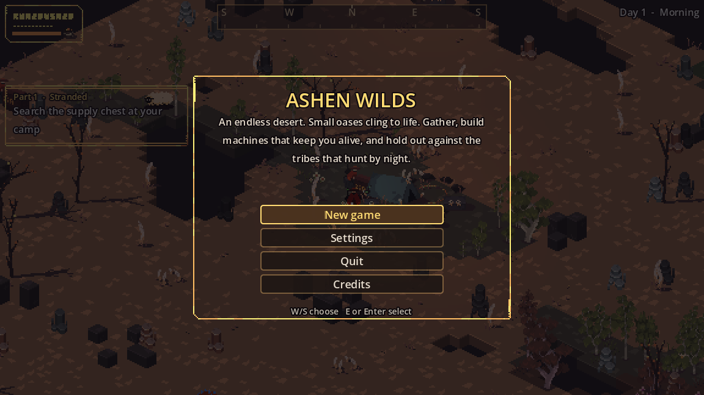

# Start here

Ashen Wilds is an isometric pixel-art survival and automation game. You are a lone swordsman stranded in a desert that never ends. The goal is simple: survive as many days as you can.

## How a run works

Every new game generates a fresh world from a random seed. You wake at a small camp inside an oasis, with a tent, a firepit, a supply chest and a parked [Speed Racer](../world/speed-racer.md).

- **Days are short.** A full day lasts 4 minutes, and the first night falls about 2.5 minutes in. See [Day and night](../world/day-night.md).
- **Resources run out.** Felled trees, mined deposits and opened chests never come back. Long-term survival means building machines.
- **Nights are dangerous.** Raiders come in growing waves after dark, and some will go after your base while you're away.
- **Death is permanent.** The game autosaves at every dawn, but when you die, your save is deleted.

## Where to go next

-   :material-calendar-today:{ .lg .middle } **[First days](first-days.md)**

    A day-by-day plan from your first workbench to a powered factory.

-   :material-format-list-checks:{ .lg .middle } **[Objectives](objectives.md)**

    All 30 tutorial goals the game walks you through.

-   :material-lightbulb-on:{ .lg .middle } **[Tips and strategy](tips.md)**

    Base layout, fuel, storms, trading and more.

-   :material-keyboard:{ .lg .middle } **[Controls](../reference/controls.md)**

    Every key and mouse button.

