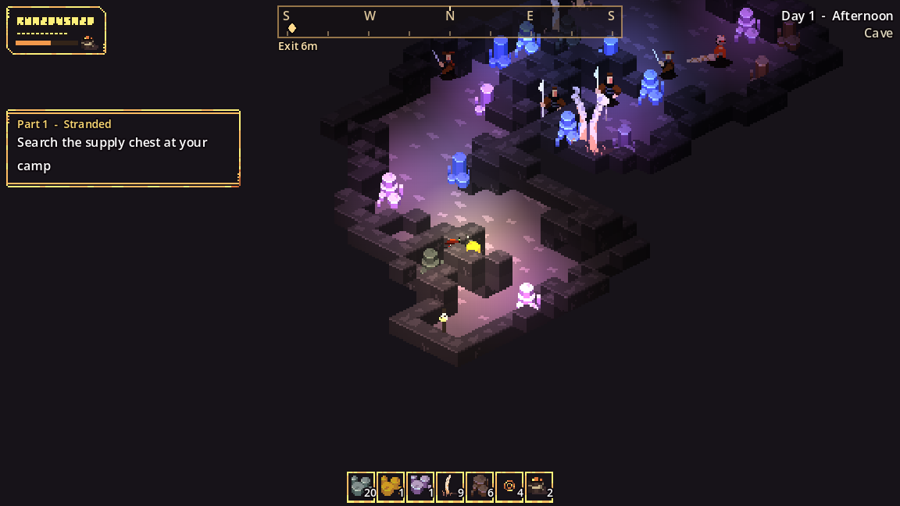

# Caves

Cave entrances are dark rock mounds found in some regions of the desert, usually ringed by rich ore. Walk into the mouth to go underground.

Each cave leads to its own tunnel system, the same every time you visit.

| What's inside | Details |
| --- | --- |
| :material-diamond-stone: Ore seams | 16 seams of gold, cobalt and amethyst (these glow in the dark), plus coal and copper. Each yields 2–4 ore. |
| :material-treasure-chest: Rich chests | Two, deep in the tunnels, with gold, amethyst and cooked meat. |
| :material-skull: Bone totems | Five of them. Break them for bone. |
| :material-sword: Tribe warriors | Five to eight Brutes, Tamed Beasts, Spear Guards, Hunters and Warriors. They stand dormant until you come within about 7 cells. |

## Rules underground

- **It's dark.** Your own light, your drone and the glowing seams are all you have.
- **It's safe from the surface.** Night raids, sandstorms and desert heat don't reach you, and raiders chasing you give up when you go down.
- **The compass shows only Exit.** The exit is the lit shaft where you arrived. Walk into it to climb out.
- **Nothing respawns.** Anything you mine or loot stays gone.

## Silencing a cave

Defeat every warrior in a cave to **silence** it. It stays empty of enemies for good, and its entrance reads "(quiet)" from then on.

!!! tip
    Wake the warriors one or two at a time by edging forward. A Tamed Beast and a Brute together can take most of your health in a few hits.

Saving while underground puts you back at the cave entrance when you load. Exploring and silencing a cave are both [objectives](../start/objectives.md) in part 6.
