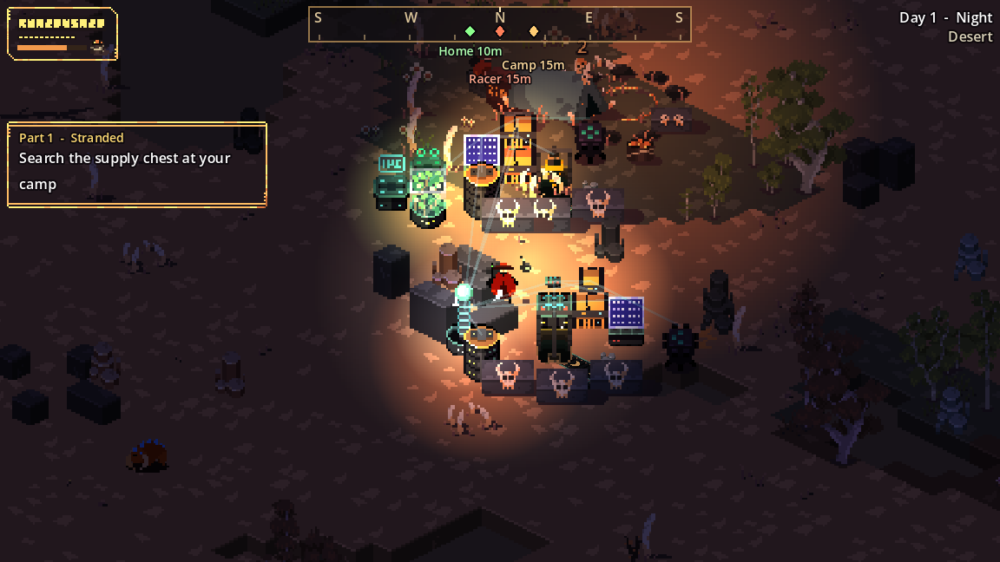

# Day and night

A full day lasts 4 minutes. Night takes about the last quarter of it, and each night the raids grow larger and tougher.

| Phase | Length | What happens |
| --- | --- | --- |
| :material-weather-sunset-up: Dawn | about 25 s | Light returns and a bell rings. The day counter goes up and the game [autosaves](../reference/saving.md). |
| :material-white-balance-sunny: Day | about 2 min 15 s | Safe to explore, but the desert is hot. From day 2, a pair of raiders may wander in and a [sandstorm](sandstorms.md) may blow. |
| :material-weather-sunset-down: Dusk | about 25 s | The sky reddens, and "Night falls" warns you that raids are coming. |
| :material-weather-night: Night | about 65 s | A horn sounds and the music darkens. Raiders spawn in waves near you. Lamps, fires and machine lights matter. |

You start on the morning of day 1, and day 1 has no daytime raiders.

## How night raids escalate

| Day | New in the raider pool | Group size | Most raiders at once |
| --- | --- | --- | --- |
| 1 | Warrior, Archer, Tribe Hunter | 1–2 | 6 |
| 2 | Spear Guard, Tribe Brute | 1–3 | 8 |
| 3 | The [Dust Jumper](../combat/boss.md) may appear (35% chance, once a night) | 1–4 | 10 |
| 4 | Tamed Beast. About one wave in four is led by a [Dust Warrior](../combat/enemies.md#elites). | 1–4 | 12 |
| 5+ | [Electrocutioners](../combat/enemies.md#elites) can lead waves too | 1–4 | 14, then +2 a day up to 16 |

Groups spawn just off screen every few seconds, and the gap shrinks each day. Raiders who fall far behind you give up and vanish.

Some groups ignore you and go for your base instead. See [Base raids](../combat/base-raids.md).
