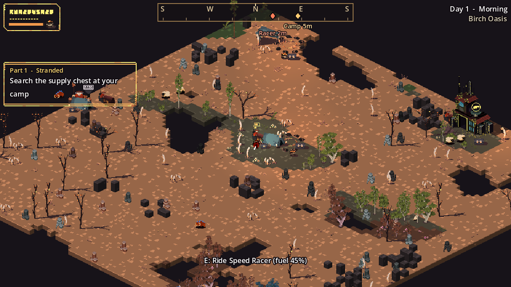

# The world

Every run generates a new world from a random seed. It has no edge, and it loads in chunks around you as you travel. Most of it is desert; living biomes exist only as small oases, usually 10 to 20 cells across.

## Biomes

| Biome | Trees and plants | Animals | Ore found here |
| --- | --- | --- | --- |
| :material-weather-sunny: Desert | Dead trees, bones, dry tufts | Rare boar | Stone, copper, coal |
| :material-fire: Scorched Badlands | Dead trees | None | Coal, gold |
| :material-tree: Greenwood Oasis | Green trees, berry bushes, flowers | Sheep, chicken, rabbit | Stone, copper |
| :material-tree-outline: Birch Oasis | Birch trees, berry bushes | Rabbit, sheep | Stone, copper |
| :material-leaf-maple: Autumn Oasis | Autumn trees, berry bushes | Boar, chicken | Copper, gold |
| :material-flower: Crimson Oasis | Crimson trees, berry bushes | Boar | Gold, amethyst |
| :material-diamond-stone: Violet Oasis | Violet trees, berry bushes | Rabbit | Amethyst, cobalt |
| :material-snowflake: Frost Oasis | Teal trees, berry bushes | Rabbit, sheep | Cobalt, stone |

The Desert and the Badlands are hot by day, which makes you hungry faster (see [Survival](../survival/index.md#desert-heat)). Each oasis is ringed by a fringe of scrubby sand.

## Terrain

Chasms
:   Bottomless gaps in the ground. You can't cross them on foot or by racer.

Rock outcrops
:   Clusters of raised stone blocks on high ground. Break them for stone. Ore deposits sit among them too.

## Landmarks

The world is divided into regions of 40 by 40 cells, and about two thirds of regions hold one landmark.

| Landmark | What you'll find |
| --- | --- |
| Camp | Tents, a lit firepit, a loot chest and baskets |
| Ruin | A sci-fi building, a loot chest, a lamp, and sometimes a Speed Racer |
| Merchant camp | A [trader](merchants.md), a tent, a lamp, and sometimes a Speed Racer |
| Tribe camp | A large tribal tent, bone totems and a rich chest |
| Bone field | Giant bones, bone totems and a chest |
| Cave | A rock mound ringed by rich ore. It leads underground: see [Caves](caves.md). |

!!! info "Nothing grows back"
    Felled trees, mined deposits, opened chests and found racers stay gone, even after you save and load. Only berry bushes regrow, 4 minutes after you pick them.

## More about the world

-   :material-weather-sunset:{ .lg .middle } **[Day and night](day-night.md)**

    The 4-minute day, and how night raids escalate.

-   :material-weather-windy:{ .lg .middle } **[Sandstorms](sandstorms.md)**

    Wind, haze and failing solar power.

-   :material-tunnel:{ .lg .middle } **[Caves](caves.md)**

    Dark tunnels full of rich ore and sleeping warriors.

-   :material-motorbike:{ .lg .middle } **[Speed Racer](speed-racer.md)**

    A hover-bike for crossing the desert fast.

-   :material-store:{ .lg .middle } **[Merchants and loot](merchants.md)**

    Trades, and what's inside each kind of chest.

