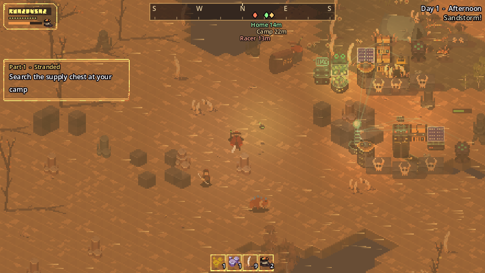

# Sandstorms

Sandstorms are daytime weather events. They can start from day 2, and at most one blows each day.

## How a storm plays out

| Stage | Length | What happens |
| --- | --- | --- |
| Warning | 5 s | "The wind is rising..." and a low rumble. The air starts to haze. |
| Storm | about 50 s | "Sandstorm!" Thick dusty haze, sand streaking across the screen, howling wind. |
| Easing | a few seconds | The wind dies down: "The sandstorm passes." |

## Effects

- **Wind:** you, raiders and the Speed Racer are pushed in one direction, which slowly drifts during the storm. Walking into the wind is slow; walking with it is fast.
- **Visibility:** the light turns dim and orange.
- **Solar power:** solar panels produce only 30% while the storm blows. Batteries and generators are unaffected.

## Taking shelter

!!! success "Ride it out at home"
    Within a few cells of your own structures, the wind is cut to 15% of its strength. The safest place in a storm is your base.

Caves are also completely sheltered. Weathering a sandstorm is one of the [objectives](../start/objectives.md) in part 6.
