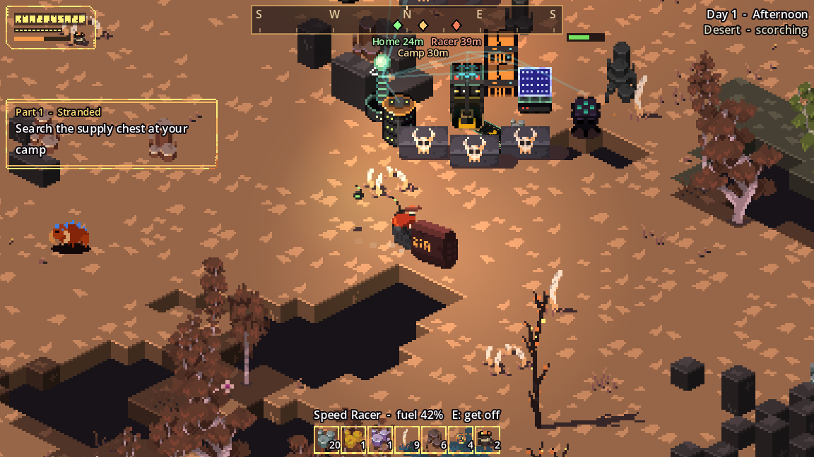

# Speed Racer

The Speed Racer is a hover-bike that crosses the desert about 2.5 times faster than walking. One is always parked at your starting camp, and ruins and merchant camps sometimes have another.

<strong>185</strong>top speed (walking is 72)

<strong>~45 s</strong>flat out on a full tank

<strong>40</strong>crawl speed when empty

<strong>2–3</strong>ramming damage

## Fuel

| | |
| --- | --- |
| Fuel use | About 2.2% per second at full throttle |
| Refuelling | Automatic when you get on: each Fuel adds 35%, each Coal 12%, up to about 92% |
| Starting fuel | 45% at the start camp, 20–60% when found elsewhere |

## Riding

- **Get on and off** by using the racer. While riding you steer with the movement keys and can still eat.
- **Ramming** a raider or animal at speed deals 2 damage, or 3 near top speed, and slows you down.
- **Crashing** into a tree, rock or building costs most of your speed.
- **Limits:** racers can't cross chasms, and raiders can still hurt you while you ride. Your drone sits out while you're driving.
- **Parking:** a racer stays exactly where you leave it, and its headlight helps at night. The compass's **Racer** marker points to the nearest empty one.
